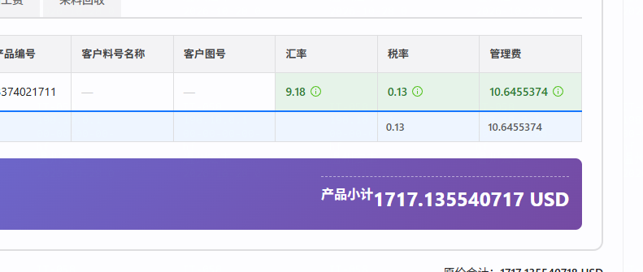

# 报价卡片含税总计展示

| 项 | 值 |
|---|---|
| 立项日期 | 2026-10-28 |
| 路径 | A · 标准档（金额展示口径 + 报价渲染主链） |
| 状态 | 立项 · A0 已定稿 · 闸门 A 待用户确认 |
| 父任务 | `dev-docs/task-260801-公式计算精度优化/` |
| 关联 Backlog | `BL-0332` |

## ① 背景与目标

报价单产品卡片底部现在只显示一行税前产品小计，文案为“产品小计”。用户需要移除该文案，并在税前价格下方增加税后价格，税后价使用当前报价行已冻结的卡片税率计算。

目标是让销售在一张产品卡片上同时看到税前与税后价格，不改变现有产品小计、税率快照、计算过程、保存值或历史报价事实。

## ② 范围

### 本期做什么

- 报价编辑页的报价侧产品卡片底部移除“产品小计”文案。
- 报价详情页与其他复用报价侧只读卡片的入口同步改动，与编辑态展示一致。
- 保留当前税前价格，在其下方增加税后价格：`taxInclusive = productSubtotal × (1 + vatRateRatio)`。
- 税率只读取报价行已冻结的 `vatRateRatio`；兼容仅有 `vatRate` 百分比值时除以 100，不回查当前主数据。
- 延续现行 Decimal 12 位计算工作值、`HALF_UP` 和去尾零规则；最终显示继续受角色上限约束：销售代表/销售经理最多 4 位，定价经理/系统管理员最多 9 位。
- 币种与当前税前价格保持一致。税率为 0% 时两个金额相等；税率快照缺失或非法时税后价格显示 `-`，页面不出现错误遮罩。

### 本期明确不做什么

- 不改产品小计的取数与计算来源，不重算卡片内页签数据。
- 不把税后价格写入 API DTO、关系型列、JSONB 快照、草稿保存或提交对账值。
- 不改报价单总计、折扣、年量、导出、邮件附件、Excel 视图或比对视图。
- 不改卡片头部 VAT/利润提示框和税率冻结规则。
- 不改核价侧产品卡片现有的 CNY/外币两行小计。
- 不新增后端接口、数据库字段、Flyway 迁移或系统参数。
- 未收到后续明确“打包”或“部署”指令时，不更新 `deploy/`。

## ③ 验收标准

> 2026-10-28 用户确认 A0 定稿：两行都不显示“税前价格”或“税后价格”；仅在第二行含税金额前显示 `(VAT)`。验收基准是 `原型图/05-定稿候选-编辑态.html` 与 `06-定稿候选-只读与边界态.html`。

- **AC-1 · 默认布局与精确值（单点）**：以系统管理员打开私有测试报价的编辑第 2 步，目标卡片产品小计为 `1717.135540717`、`vatRateRatio="0.13"`、币种为 `USD`。卡片底部第一行只有 `1717.135540717 USD`，第二行只有 `(VAT) 1940.36316101 USD`；总计区 DOM 不含“产品小计”“税前价格”“税后价格”。卡片头部 VAT/利润提示、页签、表格和删除入口与改造前一致。
- **AC-2 · 角色显示位数（单点）**：对同一张 AC-1 卡片依次使用 `maxDisplayDecimals=4` 和 `9` 渲染。销售代表/销售经理的两行分别为 `1717.1355 USD` / `(VAT) 1940.3632 USD`；定价经理/系统管理员分别为 `1717.135540717 USD` / `(VAT) 1940.36316101 USD`。税后派生值仅在显示边界舍入，不经 JavaScript `number`。
- **AC-3 · 编辑/详情连续一致（序列）**：打开 AC-1 报价的编辑第 2 步记录两行文本 → 进入同一报价详情页记录两行文本 → 回到编辑页并刷新。三次都精确等于 AC-1 的两行，顺序不变；产品卡片数始终非 0，“加载中”、红色错误 Alert 和框架错误遮罩最终均为 0。
- **AC-4 · 税率来源与异常边界（边界）**：通过纯函数/组件夹具分别渲染：① `vatRateRatio="0"` → 第二行 `(VAT) 1717.135540717 USD`；② 无 `vatRateRatio`、`vatRate="13"` → `(VAT) 1940.36316101 USD`；③ `vatRateRatio="0.13"`、`vatRate="5"` → 仍按 ratio 得 `(VAT) 1940.36316101 USD`；④两字段均缺失、ratio 非数字、小于 0 或大于 1 → 第二行 `(VAT) -`。所有情形的第一行仍正常，不抛异常。
- **AC-5 · 保存与历史事实不变（序列）**：销售经理打开 AC-1 草稿，先记录 `GET` 响应中的产品小计、`vatRate`、`vatRateRatio`、卡片快照和修改时间，只修改“关联项目”文本后保存并刷新。除该文本与既有修改时间外，上述值逐字不变；请求/响应不新增税后金额字段，不将显示文本写入快照。
- **AC-6 · 核价侧无回归（反向）**：在编辑态与只读态各打开一张有同款产品卡片的核价单。两处仍只显示既有“产品小计 / 外币小计”两行，不出现 `(VAT)`，金额和币种与改造前一致。
- **AC-7 · 长值与窄屏（边界）**：将共享呈现组件传入 `99999999999999.999999999`、`vatRateRatio="0.99999999999"`、币种 `USDT`，在 1280×720 与 390×844 视口各打开一次。两行均在卡片内右对齐，`(VAT)` 与第二行金额同行且前缀在前；数值内部不断行，不覆盖另一行，`document.scrollWidth === document.clientWidth`。
- **AC-8 · 回归与可构建（反向）**：执行前端类型检查、本任务定向 Vitest、相关既有产品小计/角色精度测试、生产构建和本任务 Playwright。各命令退出码均为 0；E2E 中编辑/详情两处各唯一命中 1 张目标卡片，控制台 `error/warn` 为 0，无框架错误遮罩。已知 `quotation-flow.spec.ts` 因 `DEC-0008` 不作为本任务通过证据，若用它回归只记同型 A/B 差异。

## ④ 依赖与影响面

- 编辑态落点：`cpq-frontend/src/pages/quotation/QuotationStep2.tsx`，现有报价侧总计仅一行。
- 只读态落点：`cpq-frontend/src/pages/quotation/ReadonlyProductCard.tsx`，需保留 `isCosting` 分支的 CNY/外币口径。
- 样式落点：`cpq-frontend/src/pages/quotation/quotation.css` 中 `.qt-subtotal-*` 系列。
- 依赖现行税率快照字段 `vatRate` / `vatRateRatio`，以及报价角色显示上限 `maxDisplayDecimals`。
- `QuotationStep2.tsx` 与 `ReadonlyProductCard.tsx` 均属报价渲染主链；开工后必须按 `change-protocol.md` 列出编辑/详情/核价三分支检查点并跑 E2E。
- 不修改字段类型、DTO、API 或 DB schema，不触发 AP-44 字段类型传播矩阵。
- 不破坏 `docs/三大核心模块基线.md` 的模板冻结、driver 展开、页签结构或产品小计权威来源；仅在报价卡片最终呈现边界派生一个不落库的含税文本。

### A0 裁决：总计区布局

- **用户反馈**：方案甲/乙都不需要显示“税前价格”和“税后价格”字样；在税后金额前面加 `(VAT)` 即可。
- **用户定稿（2026-10-28）**：第一行仅显示大号税前金额；第二行小号显示 `(VAT)` 与含税金额，两者同行、右对齐。卡片头部已有冻结 VAT 税率提示，第二行不重复税率数值。

## ⑤ 用户原话与素材归档

> “1.产品卡片中, 卡片的总计行,移除显示‘产品小计:’的字样”

> “2.卡片总计行,当前显示的价格是税前价格,在价格下方再显示一个税后价格,使用卡片上的税率进行计算,展示”

> “出原型给我确认”

> “都不需要显示税前价格和税后价格的字样, 在税后价格的价格前面加一个\"(VAT)\"就可以了.”

> “可以,定稿”（2026-10-28）

用户截图：

