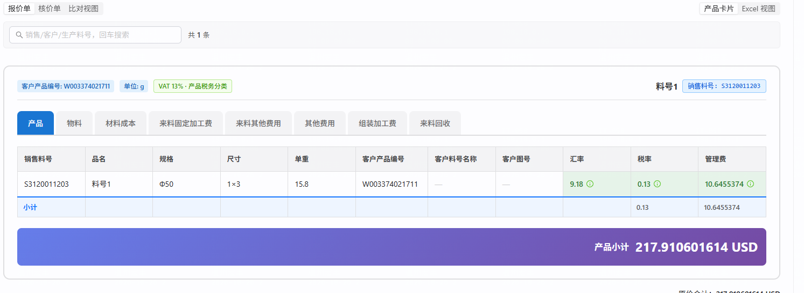

# 需求文档：物料利润字段

> 状态：🟠 开发中（验收期扩围）；路径 A 标准档；首批已合并 `master`（`48505f24`，2026-10-26）；报价单卡片扩展闸门 A 已于 2026-10-26 通过，开发分支 `feat/task-261026-quote-profit-card`；建立日期：2026-10-26。
> 方案分流：首批唯一合规路径是沿用数据集 Registry、通用料号维护端点与语义图字段树；验收期新增“报价单产品卡片展示利润”后，用户于 2026-10-26 裁决采用报价行快照，历史报价不回填。

## ① 背景与目标

报价基础数据导入的「物料」Sheet 当前没有「利润」。用户要求新增该字段，并满足三条业务链：

1. Excel 可导入「利润」，单元格非必填，但非空时必须是数字；
2. 导入后成为销售产品基础属性，在「产品管理 → 销售产品」列表直接展示、维护；
3. 在「组件管理 → 取数配置」选择数据源「物料」时，字段列表增加可选字段「利润」。
4. 报价单产品卡片在 VAT 提示框右侧显示报价行冻结的利润；历史报价未冻结利润时显示 `利润: -`。

## ② 范围

### 做什么

- `ds_quote_material` 新增可空 `profit numeric(26,12)`；只属于报价侧物料，不扩散到基础核价或详细核价物料表。
- 报价数据导入模板「物料」Sheet 在现有 9 列末尾追加表头「利润」；表头仍是模板必备列，单元格可空。
- 非空利润接受普通有符号数字，包括负数、零和小数；按现有十进制定点链路保存，不赋予百分比或币种含义。
- 导入时利润非空则覆盖当前值；利润空白时保留该客户、该销售料号已有利润，避免页面维护值被后续导入冲掉。
- 销售产品列表在「增值税」之后紧跟「利润」列；以字符串接收后端 `numeric`，右对齐展示并支持行内编辑。
- 页面显式清空利润时写入数据库 `NULL`；保存失败回滚原显示值，不能假成功。
- 报价侧物料语义节点新增 `profit / 利润 / NUMBER`，取数配置的「物料」字段列表自动展示；拖入后默认字段类型为「数字输入」。
- `quotation_line_item` 新增可空 `profit_snapshot numeric(26,12)`，只在新报价行创建时从该客户的销售产品利润冻结一次；迁移不回填任何存量报价行。
- 报价单编辑态与只读详情态产品卡片均在 VAT 提示框右侧显示利润提示框：有值按现行 `DISPLAY_SCALE=9`（`HALF_UP`、去尾零）显示 `利润: <十进制值>`，无值显示精确文案 `利润: -`；接口和快照仍保留完整 12 位小数。
- 从已有产品添加、基础数据导入建单、选配/绑定产品、草稿首次保存和报价单复制均遵守同一快照语义；复制报价单继承源行快照，不重新读取基础数据。
- 补齐字段矩阵、正式报价导入模板、接口总表、自动化测试与任务测试报告。

### 明确不做

- 不让利润参与报价、核价、公式、含税价或任何自动计算；本期只负责保存、展示、维护与取数。
- 不增加利润率、利润币种、利润来源或审计历史等衍生字段。
- 不给 `ds_cost_basic_material`、`ds_cost_detail_material` 增加利润。
- 不自动改写任何存量组件的已选列、已发布模板或快照；配置人员按需拖入「利润」后才生效。
- 不给历史 `quotation_line_item` 回填利润；历史行即使对应销售产品当前已维护利润，卡片仍显示 `利润: -`。
- 不因保存草稿、重算、刷新基础数据或后续维护销售产品利润而更新已存在报价行的利润快照。
- 不把利润加入报价单 Excel/PDF 导出、金额计算、折扣、税额或报价比较字段。
- 不改销售产品抽屉；维护入口只在列表利润单元格。
- 不放宽现有严格表头规则：旧 9 列模板缺少「利润」表头会被判为模板不完整；升级为 10 列模板后，利润单元格可留空。
- 不生成部署包；用户本次未明确要求打包或部署。

### 已确认口径

| 编号 | 用户选择 / 需求 | 落地口径 |
|---|---|---|
| D-1 | `1A` | 利润是普通有符号数字，允许负数、零、小数；存储类型 `numeric(26,12)`。 |
| D-2 | `2A` | Excel 利润空白不覆盖销售产品中已维护的利润；非空才覆盖。 |
| D-3 | “导入后设置为销售产品的基础属性，在产品列表中可以直接展示和维护” | 列表增加行内编辑；显式清空写 `NULL`，按 `(customer_no, material_no)` 精确更新。 |
| D-4 | “物料的引用字段列表增加利润字段” | 语义图物料节点追加字段；仅扩大可选字段，不自动改已有组件配置。 |
| D-5 | “位置紧跟增值税吧” | 用户验收期调整列序：「利润」紧跟「增值税」，后面为「产品分类」；其余显示与编辑交互不变。 |
| D-6 | “报价单的产品卡片中……在税率右侧增加利润的提示框；没有维护利润显示 `利润: -`” | 编辑态与只读态卡片均新增独立利润提示框，位置紧跟 VAT；数值按现行最多 9 位小数、`HALF_UP`、去尾零的展示规则格式化，不追加 `%` 或币种。 |
| D-7 | “历史报价单不需要补充利润，直接显示 `-` 即可” | 采用报价行快照：仅新建行冻结利润；迁移不回填存量行，存量 `NULL` 恒显示 `利润: -`；复制继承源行快照。 |

## ③ 验收标准（AC）

- **AC-1 模板与元数据一致**：正式报价导入模板的「物料」Sheet 为 10 个表头，末列是「利润」；字段矩阵、`QuoteRegistry`、数据库列三者均声明 `profit numeric(26,12)`、可空。旧 9 列模板缺少「利润」表头时返回明确的缺列表头错误，不静默按旧模板导入。
- **AC-2 数字校验**：利润分别填负数、零、正小数均可导入，数据库值不经 `double`；填 `abc` 时 HTTP 400，错误定位到 Sheet「物料」、对应行和列「利润」，整份文件不写入任何数据。
- **AC-3 初次空值**：新物料的利润单元格为空时导入成功，`ds_quote_material.profit IS NULL`。
- **AC-4 非空覆盖**：同一客户、同一销售料号再次导入非空利润时，以新值覆盖旧值；其他物料属性仍按现有导入语义处理。
- **AC-5 空白保留（D-2）**：先导入利润，再通过销售产品列表改成另一数值，随后导入利润空白的同一物料；数据库、列表接口和刷新后的页面都仍是页面维护后的值。
- **AC-6 列表契约**：`GET /api/cpq/dataset/quote/parts` 的每个 item 恒含 `profit` 键，值为十进制字符串或 `null`；基础核价和详细核价响应不出现该键；端点仍恒为 count + page 两条 SQL，无逐行查询。
- **AC-7 列表展示**：按 [`原型图/01-销售产品-利润默认态.html`](原型图/01-销售产品-利润默认态.html)，「利润」紧跟「增值税」、右对齐；空值显示 `—`，长数值不撑破表格，表格保持横向滚动。
- **AC-8 列表维护**：按 [`原型图/02-销售产品-利润编辑与校验态.html`](原型图/02-销售产品-利润编辑与校验态.html)，双击或点击编辑图标进入数字输入；Enter/失焦保存，Esc 取消；负数、零、小数可保存；非数字不能提交并显示可读提示。
- **AC-9 清空与失败回滚**：列表显式清空后 PUT 发送 `{"profit":null}` 并落库 `NULL`；接口 4xx/5xx 或网络失败时恢复原值、显示“保存失败，已还原”，刷新后仍为原数据库值。状态与边界按 [`原型图/03-销售产品-利润空态失败与极值.html`](原型图/03-销售产品-利润空态失败与极值.html)。
- **AC-10 客户隔离与权限**：利润维护沿用现有四角色单列更新权限；请求恒携带被编辑行的 `customerNo`，同一销售料号存在于多个客户时只更新目标客户；漏传导致多行命中时仍由 409 守卫回滚。
- **AC-11 取数配置可选**：组件管理选择数据集 `QUOTE`、数据源「物料」时，字段树的物料分组出现 `{sourceNodeKey:"MATERIAL", sourceColumn:"profit", displayName:"利润", dataType:"NUMBER", viewColumn:"_物料_利润"}`；可拖入已选列，默认字段类型为 `INPUT_NUMBER`，编译/预览能选择 `ds_quote_material.profit`。
- **AC-12 存量零改写**：迁移前后已有组件 `builder_config`、组件字段、已发布模板与报价/核价快照内容和数量不因新增可选字段而变化；未选择利润的原 SQL、字段顺序和结果不变。
- **AC-13 回归边界**：其余 15 个报价 Sheet、两套核价数据集、生产料号编辑、税务分类、客户过滤、分页搜索与销售产品抽屉行为不变；前后端规定测试、自检与冷启动均通过。
- **AC-14 快照迁移与历史空值**：在含历史报价行的数据库执行新增迁移后，`quotation_line_item.profit_snapshot` 为 `numeric(26,12) NULL`；迁移前已有行的该列全部保持 `NULL`，打开这些报价单的编辑态和只读详情态时均显示精确文案 `利润: -`，不得回查 `ds_quote_material.profit` 补值。
- **AC-15 新行冻结与精度**：销售产品利润分别为 `12.500000000000`、`0`、`-2.125000000000`、`1.234567891500` 和 `NULL` 时，通过“从已有产品添加”或基础数据导入建单新增报价行；首次显示分别为 `利润: 12.5`、`利润: 0`、`利润: -2.125`、`利润: 1.234567892`、`利润: -`，保存并刷新后不变；接口以保留数据库 scale 的十进制字符串或 `null` 返回，前端不得经 JavaScript `number` 丢精度。
- **AC-16 卡片位置与双视图**：按 [`原型图/04-报价单编辑态-利润提示框.html`](原型图/04-报价单编辑态-利润提示框.html) 和 [`原型图/05-报价单只读态-利润提示框.html`](原型图/05-报价单只读态-利润提示框.html)，编辑态与只读态的利润提示框都紧跟 VAT 提示框之后；客户产品编号、单位、VAT、产品分类、产品名、销售料号和删除按钮的既有顺序及交互不变，最长 `numeric(26,12)` 值经现行 9 位显示边界格式化后仍不挤乱头部布局。
- **AC-17 快照不漂移序列**：新报价行以销售产品利润 `1.25` 创建并保存后，将销售产品列表利润改为 `9.5`，再依次重算、刷新基础数据、切走返回、刷新浏览器并打开只读详情；该报价行始终显示 `利润: 1.25`。在同一报价单中新加一次同料号，新行显示 `利润: 9.5`，旧行仍为 `利润: 1.25`。
- **AC-18 创建路径与复制边界**：选配新铸产品（基础利润为空）显示 `利润: -`；直接绑定已有且利润为 `3.75` 的销售产品显示 `利润: 3.75`；复制含 `1.25` 快照的报价单后副本仍为 `1.25`，复制历史 `NULL` 行后副本仍显示 `利润: -`。上述路径不得增加逐行利润查询，利润不参与任何小计、税额、折扣、报价/核价公式或导出。
- **AC-19 协议兼容**：`GET /api/cpq/quotations/{id}` 的 `lineItems[].profit`、候选与已有产品接口的 `profit` 均为十进制字符串或 `null`；旧请求不带利润字段仍能保存，保存历史草稿不得把 `null` 回填为当前基础利润，新前端收到旧后端缺失字段时显示 `利润: -`。
- **AC-20 自检与真实链路**：前端类型检查/构建、后端定向与相关回归测试、报价主流程与只读详情 E2E、Flyway 冷启动、页面身份、非空渲染、错误遮罩、控制台健康和目标交互全部通过；真实测试服务器验收前由用户另行明确触发部署，本次开工不自动生成部署包。

## ④ 依赖与影响面

- **数据库**：首批利润字段迁移 `V454` 已在主仓、开发库与测试库落地；报价行利润快照需要再新增一条加法 Flyway 迁移。2026-10-26 闸门 A 前复核主仓、全部 worktree、开发库、测试库及构建输出五方，最大版本均未超过 `V454`，所以扩围迁移当前候选为 `V455`；真正建文件前仍须再次五方核号，不能提前锁死编号。
- **导入链**：`QuoteRegistry` → `DatasetSheetParser` → `DatasetImportValidator` → `PlainTableWriter`。利用现有 DECIMAL 校验和 `preserveOnNull`，不新增平行解析器。
- **销售产品链**：`DatasetMaintenanceService` / `DsPartsPage` / 通用单列更新端点 → `productHubTypes.ts` / `productHubApi.ts` / `ProductSalesPartTab.tsx` / 新的专用利润编辑单元格。
- **取数配置链**：Flyway 只向 `semantic_node_column` 的报价 `MATERIAL` 节点追加一列；`SemanticGraphLoader` 重启加载后，`FieldTreeBuilder` 与 `SemanticCompiler` 沿用通用逻辑。前端配置器不硬编码字段。
- **规范源**：正式报价 XLSX 是字段矩阵的上游权威源，改动后必须重跑 `gen_matrix.py`，并让 `DatasetStructureAcTest` 用文档判据验证数据库列集合。
- **并发热点**：主工作区已有用户对 `ProductSalesPartTab.tsx`、`dev-docs/INDEX.md` 等文件的未提交修改；实现必须从闸门 A 后的专用 worktree 开始，合并前先吸收最新 `master`，不得覆盖现有改动。
- **启动要求**：DDL 和语义图种子落地后必须冷启动后端，确认 Flyway 成功、Schema 自检通过且新字段进入不可变语义图快照。
- **报价行快照链**：新增加法迁移（当前候选 `V455`，开工前重新五方核号）→ `QuotationLineItem` / `QuotationDTO.LineItemDTO` → 新行创建与复制路径 → `QuotationWizard` 的加载/新增映射 → 编辑态 `QuotationStep2` 与只读态 `ReadonlyProductCard`。
- **新增产品入口**：`CustomerPartCandidateService`、`ExistingProductService`、`QuotationLineItemMaterializeService`、`ConfigureProductService` 和 `QuotationService.saveDraft/copy` 必须共同覆盖；利润批量解析或内联查询，禁止循环逐行查库。
- **协议检查点**：物理列、实体、读 DTO、两个候选 DTO、已有产品 DTO、前端三份类型、构建新行映射、两处 GET 回填、草稿新增行持久化、导入批量建行、选配/绑定落行、复制、编辑卡片、只读卡片、历史 `NULL`、精度字符串、N+1、E2E 双视图共 19 项，开发中逐项勾验。
- **架构基线**：触及报价单渲染主链路和跨端 DTO，但不改变组件/模板/报价三层结构、不改变公式或卡片值快照；按 `change-protocol.md` 执行协议级检查与双视图 E2E。

## ⑤ 用户原话与素材归档

> 好的,我现在要在这个物料sheet增加字段"利润",非必填,做数字检查

> 1.导入后设置为销售产品的基础属性,在产品列表中可以直接展示和维护

> 1A,2A

> 3.在组件管理的取数配置中,物料的引用字段列表增加利润字段.

> 位置紧跟增值税吧

> 好,  ,现在报价单的产品卡片中,有单位,税率的提示框,  在税率右侧增加利润的提示框"利润：xx",  如果产品没有维护利润,则显示: "利润: -"

> 路径A,历史报价单不需要补充利润,直接显示"-"即可

首批页面基线来自现有产品管理代码与历史原型；验收期扩围的报价单卡片基线来自用户截图及新增 04/05 原型。数据库字段清单于 2026-10-26 对 `cpq_db_0724`、`cpq_db_test` 只读实查；截图料号 `S3120011203` 在 `cpq_db_0724` 的 `ds_quote_material.profit IS NULL`，因此该样例的预期文案是 `利润: -`。
