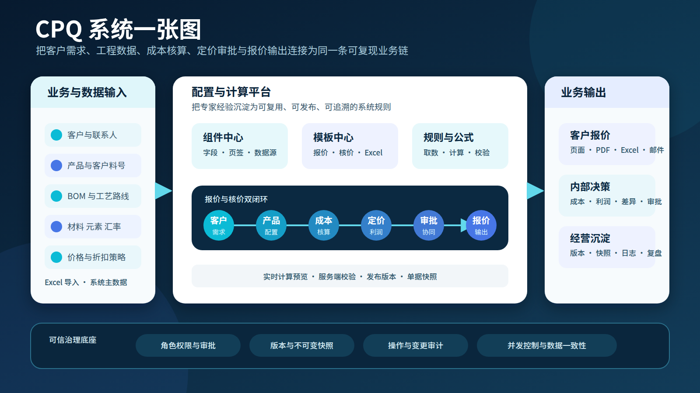
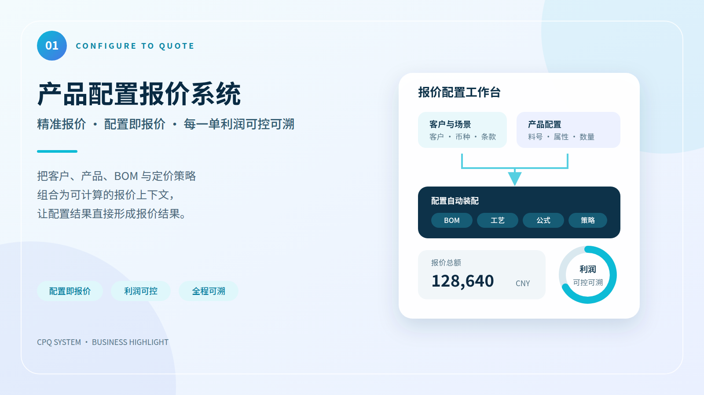
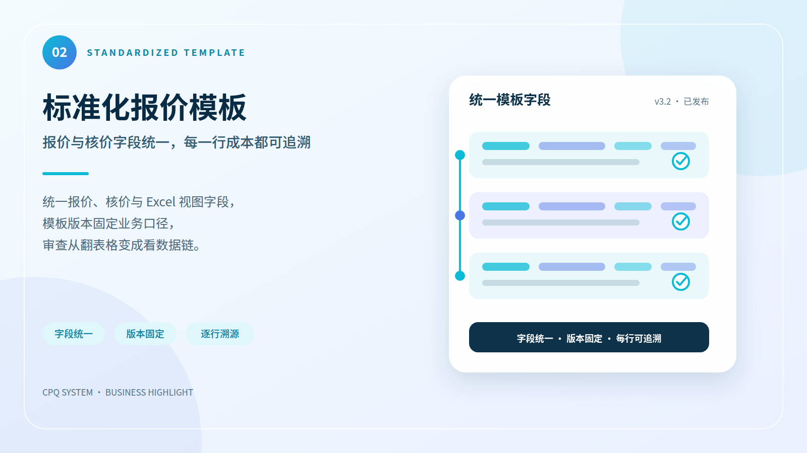
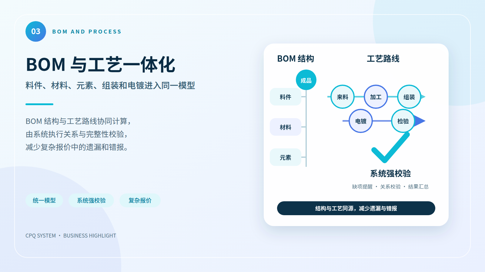
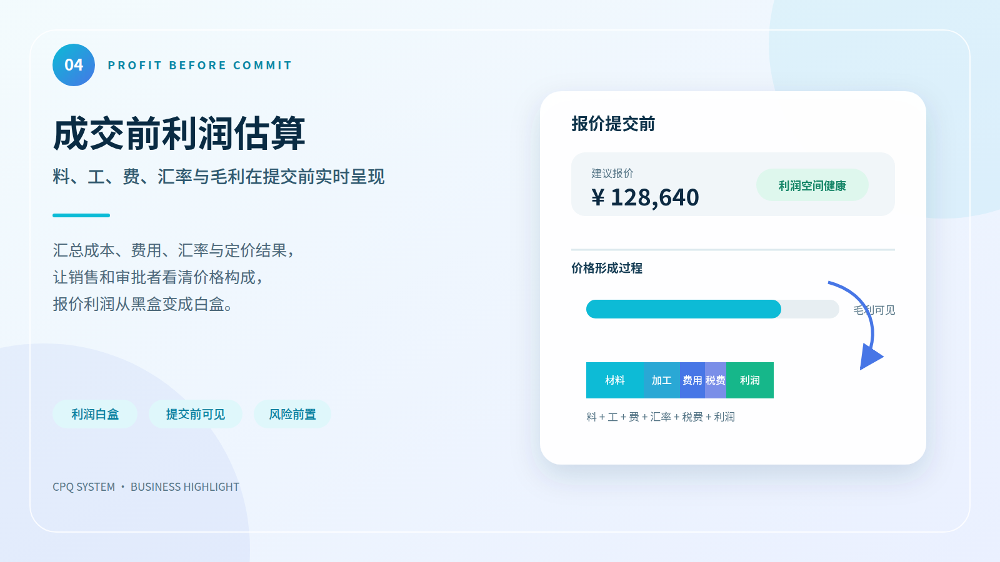
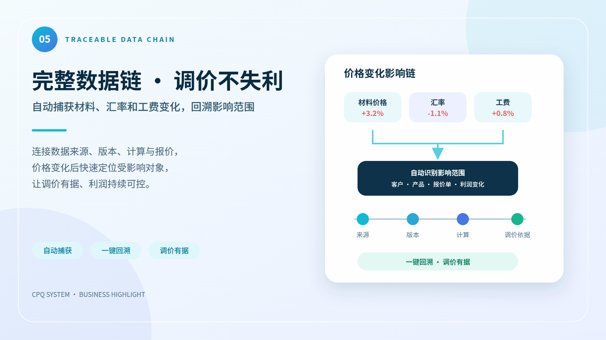
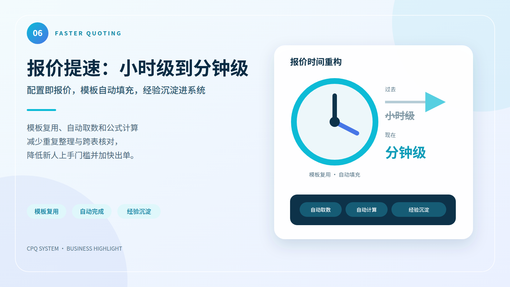

# CPQ 系统白皮书

> 面向制造业的配置化报价、成本核算与决策协同平台

**版本：** 1.0

**日期：** 2026 年 10 月 28 日

**编制：** CPQ 项目组

本白皮书面向企业管理者、销售运营、定价与财务团队、产品与工艺团队，以及信息化建设人员。内容说明 CPQ 系统解决什么问题、如何形成业务闭环、核心能力和系统亮点是什么，以及系统如何保证报价结果可复现、可审查、可追溯。

本文不是操作手册，不包含菜单路径、按钮说明或逐步配置方法。

---

## 目录

1. 执行摘要
2. CPQ 系统一张图
3. 业务背景与建设目标
4. 系统定位与业务边界
5. 端到端业务闭环
6. 系统亮点
7. 功能能力全景
8. 关键业务机制
9. 可信报价治理
10. 技术架构与集成
11. 企业价值
12. 典型应用场景
13. 建设边界与成功条件
14. 结语
15. 附录

## 执行摘要

制造业报价不是简单的“数量乘单价”。一份可交付、可审批、可复盘的报价，往往同时依赖客户条款、产品结构、BOM、材料与元素价格、加工工艺、汇率、折扣、税费、模板版本和审批规则。当这些知识散落在个人经验、Excel 文件与多个业务系统中时，企业通常面临三个问题：报价慢、口径不一、结果难解释。

CPQ 系统以“配置、定价、报价”为主线，把销售需求、工程数据、成本核算、定价策略、审批协同和客户输出连接为同一条数据链。系统通过组件化模板承载不同产品与客户的报价结构，通过公式和数据源自动取数与计算，通过报价与核价双闭环兼顾对外价格和内部成本，并通过版本、快照与日志保留当时的业务依据。

系统的核心价值不是把一张 Excel 搬到网页上，而是把企业报价能力从“个人会做”升级为“组织可复制”：

- 把产品知识、成本结构和定价规则沉淀为可复用配置；
- 把客户需求到报价输出的协作过程标准化；
- 把价格形成过程从结果黑盒转为可解释白盒；
- 把每次报价的输入、版本、计算、审批和输出固化为可追溯记录；
- 在基础数据和模板成熟后，推动报价从小时级人工整理走向分钟级系统出单。

## CPQ 系统一张图

这张图概括了系统的四个层次：业务与数据输入、配置与计算平台、业务输出，以及贯穿全程的可信治理底座。客户、产品、BOM、工艺、价格和汇率等事实进入平台后，由组件、模板、规则和公式组织成报价与核价流程；最终形成面向客户的报价文件、面向内部的成本与利润判断，以及可供复盘的版本和审计记录。

---

## 1 业务背景与建设目标

### 1.1 制造业报价的典型难题

传统报价通常依赖多个部门串行协作。销售收集客户需求，工程人员确认产品结构和工艺，采购或财务提供材料、元素、汇率与费用信息，定价人员核算成本和利润，管理者完成审批，最后再整理为客户文件。任何一项数据变化，都可能触发重新查数、重新计算和重新核对。

常见问题包括：

- **知识分散。** 产品结构、工艺成本和定价经验掌握在少数人员手中，新人难以快速复制成熟做法。
- **表格分叉。** 不同客户、产品和人员维护不同 Excel，字段、公式和版本逐渐失去统一口径。
- **重复劳动。** 客户信息、料号、BOM、材料价格、汇率等数据被反复复制和核对。
- **利润滞后。** 销售看到的是最终报价数值，却难以及时判断成本变化、折扣和汇率对利润的影响。
- **历史难复现。** 基础价格或模板更新后，旧报价为什么得到当时结果，往往只能依赖人工解释。
- **协同不透明。** 提交、驳回、审批和变更分散在线下沟通中，责任边界与处理状态不清晰。

### 1.2 建设目标

CPQ 系统围绕四个目标建设：

1. **标准化。** 用统一的客户、产品、组件、模板、公式与审批口径组织报价。
2. **自动化。** 从主数据和业务数据中自动取数、计算、校验并生成输出。
3. **透明化。** 让成本、费用、价格、折扣与利润的形成过程可解释、可审查。
4. **资产化。** 把个人经验沉淀为可复用、可版本化、可持续演进的组织能力。

## 2 系统定位与业务边界

CPQ 是 Configure、Price、Quote 的缩写。系统定位于客户需求进入企业之后、正式订单形成之前的商业决策环节：

- **Configure 配置：** 选择客户、产品和模板，组合产品属性、BOM、工艺、组件和业务字段；
- **Price 定价：** 汇集成本与价格数据，执行公式、折扣、税费、汇率和审批规则，形成可解释价格；
- **Quote 报价：** 生成标准化报价内容，完成审批，并以页面、PDF、Excel 或邮件等方式输出。

系统不是 ERP、PLM 或 CRM 的替代品。它位于这些系统之间，消费客户、产品、BOM、工艺和价格等数据，把它们转化为可审批的报价结果，并可通过接口或数据源能力与企业现有系统协同。

### 2.1 报价与核价双主线

系统同时覆盖两条互相连接、又可独立运行的业务主线。

| 主线 | 主要视角 | 关注重点 | 主要结果 |
|---|---|---|---|
| 报价单 | 对外商务 | 客户、产品、数量、价格、折扣、税费、币种、条款、审批 | 面向客户的正式报价与内部审批记录 |
| 核价单 | 对内成本 | 材料、元素、工艺、加工、模具、设计、汇率和差量试算 | 面向定价与财务的成本结果和底价依据 |

核价结果可以为报价提供成本依据；报价则在成本基础上叠加客户策略、折扣、税费与商务条款。两条主线通过产品、模板、版本和单据上下文连接，避免“成本表一套、报价表另一套”的长期分叉。

### 2.2 主要使用角色

| 角色 | 在系统中的主要职责 |
|---|---|
| 销售代表 | 创建报价、选择客户和产品、补充商务信息、发起审批 |
| 销售经理 | 审核价格、折扣和条款，处理审批、驳回与复核 |
| 定价经理 | 维护成本与价格依据、执行核价和差量试算、审查利润空间 |
| 产品与工艺人员 | 维护产品、BOM、材料、元素、工艺及与报价有关的工程事实 |
| 系统管理员 | 管理用户、角色、基础配置、日志与平台运行参数 |

## 3 端到端业务闭环

### 3.1 从客户需求到报价输出

系统将报价过程组织为一条连续业务链：

1. **识别客户与场景。** 选定客户、联系人、产品分类和适用模板，确定客户专属口径。
2. **配置产品。** 添加产品或客户料号，加载产品属性、组件、BOM 与工艺信息。
3. **自动核价。** 汇集材料、元素、加工、模具、设计、汇率等数据，形成内部成本视图。
4. **形成价格。** 应用客户定价策略、折扣、税费和公式，实时呈现价格与利润相关结果。
5. **补充条款。** 固化币种、有效期、付款条件、交期和备注等商务条件。
6. **提交审批。** 按角色和规则进入审批流程，记录提交、驳回、通过等状态变化。
7. **输出与留存。** 生成客户报价，同时保留模板版本、数据快照、计算结果和审批记录。

### 3.2 报价过程中的多视图协同

同一份产品数据可以按不同业务视角呈现：

- **产品卡片视图**适合围绕产品和组件逐项确认输入、来源和计算结果；
- **Excel 视图**适合批量对照多个产品的关键字段与金额；
- **比对视图**适合审查同类产品或历史报价之间的差异；
- **核价视图**适合查看成本组成、差量试算和内部决策依据。

这些视图不是互相独立的表格，而是同一业务对象的不同表达。系统通过统一数据模型和快照机制，减少不同视图之间的结果分叉。

## 4 系统亮点

### 4.1 产品配置报价系统

系统以组件、模板、公式和数据源为核心，将不同客户、产品和工艺的差异放入配置，而不是为每种报价场景复制一套程序。组件可表达字段、页签、取数与计算；模板负责组织组件和产品卡片；公式与数据源负责把业务事实转化为报价结果。

这种方式让企业能够逐步沉淀行业知识：成熟产品可复用标准模板，特殊客户可在受控边界内扩展，业务规则变化则通过新版本演进。

### 4.2 标准化报价模板

报价模板、核价模板和 Excel 视图围绕统一字段与组件组织。模板发布后形成稳定版本，后续调整通过派生新版本完成，避免已发布口径被直接覆盖。报价单再以快照记录当时使用的模板和计算结果，使历史单据不因后来配置变化而漂移。

标准化并不等于“一套模板覆盖全部业务”，而是让差异具有明确来源、适用范围和版本边界。

### 4.3 BOM 与工艺一体化

料件、材料、元素、加工、组装、电镀、模具和设计等数据可进入同一核价与校验链。系统将工程事实与商务报价连接，减少人工在多份 BOM、工艺表和成本表之间复制、汇总与转写。

对于简单产品，模板可保持轻量；对于组合产品和多层 BOM，系统仍使用一致的数据路径和计算上下文，支持复杂产品逐层展开和汇总。

### 4.4 成交前利润估算

系统把成本、费用、汇率、客户策略、折扣、税费和报价公式放在同一业务上下文中。销售和审批人员在提交前即可看到价格形成过程与利润相关结果，及时识别缺价、异常值、单位不一致或折扣过深等风险。

前端实时计算用于业务预览，服务端在保存与提交时执行最终校验，避免仅依赖浏览器结果。价格不是孤立数字，而是带来源、公式、版本和审批上下文的业务结论。

### 4.5 完整数据链 · 调价不失利

系统从输入到输出保留关键上下文：客户与产品、模板和组件版本、数据来源、公式、计算结果、审批状态、输出内容、操作日志和变更日志。基础数据变化后，历史报价仍优先读取当时冻结的快照，而不是用当前数据重新解释过去。

因此，当价格被质疑或需要复盘时，团队可以回答三个关键问题：用了什么数据、执行了什么规则、由谁在什么状态下确认。

### 4.6 报价提速：小时级到分钟级

向导化流程、模板复用、自动取数、公式计算与标准输出共同减少重复整理。提速并非来自简单压缩审批时间，而是通过减少查数、复制、改公式、核对版本和反复解释，缩短整条报价链的等待时间。

实际效果取决于基础数据质量、模板覆盖度和业务复杂度。系统的建设方向，是让高频成熟场景从小时级人工过程走向分钟级系统出单，同时让复杂场景仍保持可解释和可审查。

## 5 功能能力全景

| 能力域 | 核心能力 | 业务价值 |
|---|---|---|
| 客户与产品 | 客户、联系人、产品、客户料号、分类与版本 | 建立报价对象和客户差异的统一身份 |
| 组件管理 | 字段、页签、数据源、公式、驱动展开、校验 | 把报价知识封装为可复用业务组件 |
| 模板体系 | 报价、核价、Excel 模板；发布、派生和版本对比 | 在标准化与客户差异之间保持边界 |
| 报价管理 | 客户选择、产品配置、价格计算、条款、审批、输出 | 串联从需求到客户报价的完整流程 |
| 核价管理 | 成本组成、价格版本、差量试算、结果发布 | 为报价提供内部成本和底价依据 |
| 定价策略 | 客户策略、折扣、阶梯、汇率和相关规则 | 将商务政策稳定地应用到报价 |
| 公式与数据源 | 产品属性、全局变量、数据库查询、路径解析、外部接口 | 统一自动取数与计算表达 |
| 基础数据导入 | 上传、预览差异、确认入库、失败回滚、导入历史 | 降低批量数据进入系统的风险 |
| 审批与通知 | 角色路由、提交、驳回、通过、催办和消息 | 让协同状态透明并形成责任记录 |
| 输出与比对 | 页面、PDF、Excel、邮件和历史比对 | 提供统一客户呈现与内部复核材料 |
| 平台治理 | 用户权限、系统配置、锁、操作日志、变更日志 | 保证运行安全、数据一致和问题可追踪 |

## 6 关键业务机制

### 6.1 组件与模板分层

组件负责描述可复用的业务单元，例如材料成本、加工费、其他费用或产品信息；模板负责按客户、产品类别或业务场景组合这些组件。分层设计避免在每张模板中重复维护相同字段和公式，也使组件升级、模板发布和历史追溯各自拥有清晰边界。

### 6.2 版本与快照

系统区分“当前配置”和“历史事实”。组件、模板、价格与基础数据可以持续演进，但已发布模板通过版本保持稳定；报价保存或提交时，关键字段、计算结果和完整产品卡片数据进入单据快照。历史单据优先使用快照呈现，从而保证复现性。

### 6.3 前后端一致性计算

报价录入需要即时反馈，因此系统在前端提供实时公式计算；保存和提交是业务承诺，因此服务端再次解析并校验。两端围绕同一字段、公式和精度契约工作，差异超出允许范围时阻止提交，而不是静默接受不一致结果。

### 6.4 数据路径与自动取数

公式可以引用产品属性、报价字段、组件小计、全局变量和基础数据路径。系统根据当前客户、料号、产品行和驱动行上下文补充查询条件，让模板编写者关注“取什么”，平台负责在正确业务范围内“从哪里取”。

### 6.5 差量试算

核价场景允许在不改写共享基础数据的前提下，对特定成本字段进行差量覆盖并重新计算。定价人员可以评估材料价格、加工费或其他输入变化的影响，同时保持团队共用主数据不被试算污染。

## 7 可信报价治理

### 7.1 权限与职责分离

系统以角色为基础控制功能和数据访问，使销售、销售经理、定价经理和系统管理员各自在职责范围内操作。审批动作、基础数据维护和系统配置具有独立权限边界，降低越权修改和口径失控风险。

### 7.2 审批状态机

报价从草稿进入提交、审批、驳回、通过、关闭或过期等状态。状态变化不仅控制可执行动作，也形成业务过程记录。审批规则可按组织和业务条件路由，让价格与条款在对外承诺前经过必要复核。

### 7.3 操作与变更审计

操作日志记录谁在何时执行了什么动作；变更日志记录关键业务对象发生了哪些变化。二者与版本、快照和审批记录结合，为问题定位、内部审查和历史复盘提供证据链。

### 7.4 数据一致性与并发控制

批量导入、主数据维护和结构调整可能与日常报价并发发生。系统通过导入隔离、事务回滚、业务锁和结构操作锁控制冲突，避免部分写入、重复处理或中间状态暴露给报价流程。

## 8 技术架构与集成

### 8.1 分层架构

系统采用浏览器访问的前后端分离架构：

- **体验层：** React 与 TypeScript 构建的业务页面，承担产品配置、实时报价、视图切换与审批交互；
- **服务层：** Java 21 与 Quarkus 提供报价、核价、模板、公式、审批、导入和治理服务；
- **数据层：** PostgreSQL 16 保存结构化业务数据，JSONB 承载可演进的组件、模板和快照配置；
- **输出层：** 通过 Excel、PDF 和邮件能力形成对外报价；
- **集成层：** 通过数据库查询、全局变量、路径解析和 HTTP 数据源连接现有业务数据与外部服务。

### 8.2 集成原则

系统集成遵循“来源明确、上下文受控、结果可冻结”三个原则：

- 外部数据进入报价前保留来源和关键业务键；
- 查询在客户、料号、产品行和报价单上下文内执行；
- 对外承诺所依赖的结果在单据中形成快照，避免外部系统后续变化影响历史报价。

ERP、PLM、CRM 或价格服务是否已经连接，取决于企业实际部署范围。白皮书描述的是系统的集成能力，不把可扩展接口等同于已完成的特定外部系统对接。

### 8.3 可演进设计

配置与业务事实分离、模板版本化、数据源适配和公式 token 化，使系统可以在保持历史稳定的同时扩展新产品、新客户和新成本项。新增能力优先以组件、模板和数据源表达；只有平台级共性能力才进入代码与数据库契约。

## 9 企业价值

### 9.1 对销售团队

- 通过标准模板和自动取数减少反复查表；
- 在录入过程中即时看到计算结果与异常；
- 用统一输出提升对客户的专业一致性；
- 降低新人对少数资深人员的依赖。

### 9.2 对定价与财务团队

- 把成本、价格、汇率、折扣和税费纳入统一上下文；
- 在审批前识别利润风险与数据缺口；
- 通过差量试算评估输入变化，不污染共享主数据；
- 通过版本和快照复现历史决策依据。

### 9.3 对产品与工艺团队

- 让 BOM、材料、元素和工艺数据直接服务于核价与报价；
- 减少工程事实在多个 Excel 之间重复维护；
- 通过组件与模板把成熟工艺的报价逻辑复用到更多产品。

### 9.4 对管理层与信息化团队

- 把报价流程从人员经验转为制度化系统能力；
- 通过角色、审批和审计建立治理边界；
- 通过统一数据模型降低长期维护和系统集成成本；
- 为报价周期、命中率、毛利和策略效果等经营分析建立可靠数据基础。

## 10 典型应用场景

### 10.1 标准产品快速报价

针对产品结构和价格规则相对稳定的业务，系统可复用已发布模板，自动加载客户、料号、价格和条款信息，完成计算与校验后进入审批和输出。此类场景最适合形成高复用、低人工介入的快速报价链。

### 10.2 复杂制造产品报价

针对多层 BOM、多个工艺页签或多种成本组成的产品，系统以组件和数据路径逐层展开，统一汇总材料、加工、组装、电镀、模具和设计等成本，并保留每项数据的来源和计算关系。

### 10.3 客户差异化定价

针对客户专属料号、折扣、币种、条款或模板要求，系统在标准能力之上应用客户上下文和策略，既保留差异，又避免复制整套报价逻辑。

### 10.4 历史报价复盘

当客户询问旧报价、价格发生争议或内部需要复盘时，系统可基于单据快照、模板版本、计算结果、审批记录与变更日志还原当时依据，减少“用今天的数据解释昨天报价”的偏差。

## 11 建设边界与成功条件

CPQ 的价值依赖业务、数据和系统三方面共同成熟。系统可以固化规则、执行计算并保留证据，但不能自动修复缺失或错误的源数据，也不能替代企业对定价政策和审批职责的治理。

成功落地通常需要：

- 明确客户、产品、BOM、工艺、价格和汇率等数据的权威来源；
- 由业务专家确认模板、公式、精度和审批口径；
- 对高频场景优先标准化，再逐步覆盖复杂和长尾场景；
- 对发布版本、历史快照和变更权限建立长期治理机制；
- 用真实报价持续验证数据质量、计算一致性和业务适配度。

当前白皮书聚焦报价、核价、配置、治理和输出核心能力，不把实验性 3D 选配、规划中的智能化能力或尚未完成的外部系统对接描述为当前稳定交付范围。

## 12 结语

CPQ 系统连接的不只是几个报价页面，而是客户需求、产品知识、工程事实、成本数据、定价政策和审批责任。通过配置化、版本化和可追溯设计，企业可以在提升报价速度的同时，保持结果的准确性、透明度和长期可复现性。

当成熟经验被沉淀为组件与模板、关键数据进入统一计算链、每次承诺都带有可复核依据时，报价就不再是一份临时表格，而会成为企业可管理、可复制、可持续优化的核心商业能力。

---

## 附录 A 术语速查

| 术语 | 含义 |
|---|---|
| CPQ | Configure、Price、Quote，即配置、定价、报价 |
| 组件 | 可复用的字段、页签、取数、公式和校验单元 |
| 模板 | 面向特定客户、产品或业务场景的组件与视图组合 |
| 报价单 | 面向客户的产品、价格、条款和审批载体 |
| 核价单 | 面向内部的成本计算、差量试算与底价依据 |
| 快照 | 在特定时点冻结的输入、配置或计算结果，用于历史复现 |
| 数据路径 | 在业务上下文内定位主数据或计算数据的统一表达 |
| 差量试算 | 不修改共享基础数据，仅在当前核价上下文覆盖输入并重算 |

## 附录 B 编制依据

本白皮书以项目当前规范与业务文档为依据，重点参考：

- `CLAUDE.md` 中的项目定位、技术栈与部署边界；
- `docs/PRD-v3.md` 中的业务目标、报价主线、核价主线、配置中心和平台能力；
- `docs/报价单核价单功能总结.md` 中的双主线关系、模板体系、快照和数据流；
- `docs/三大核心模块基线.md` 中的组件、模板与报价渲染基线；
- `docs/架构基线.md` 与 `docs/配置中心架构.md` 中的版本、配置与数据源边界；
- 截至 2026 年 10 月 28 日的 `docs/RECORD.md` 项目记录。
